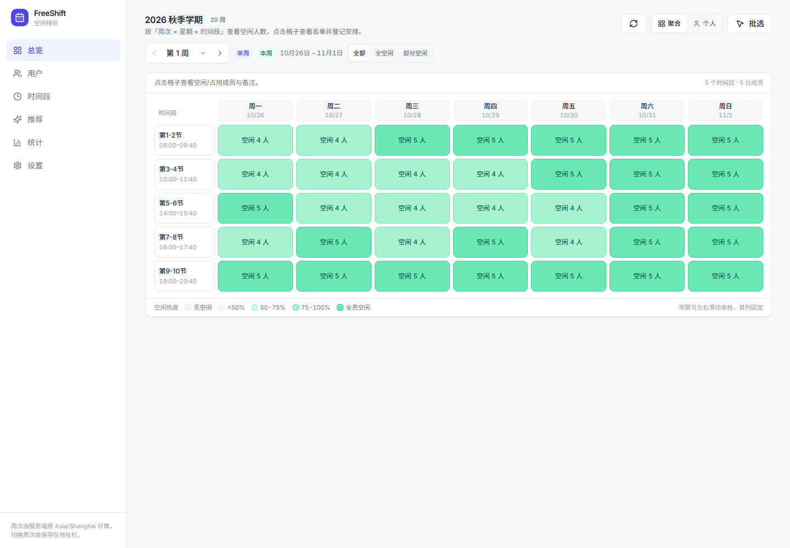
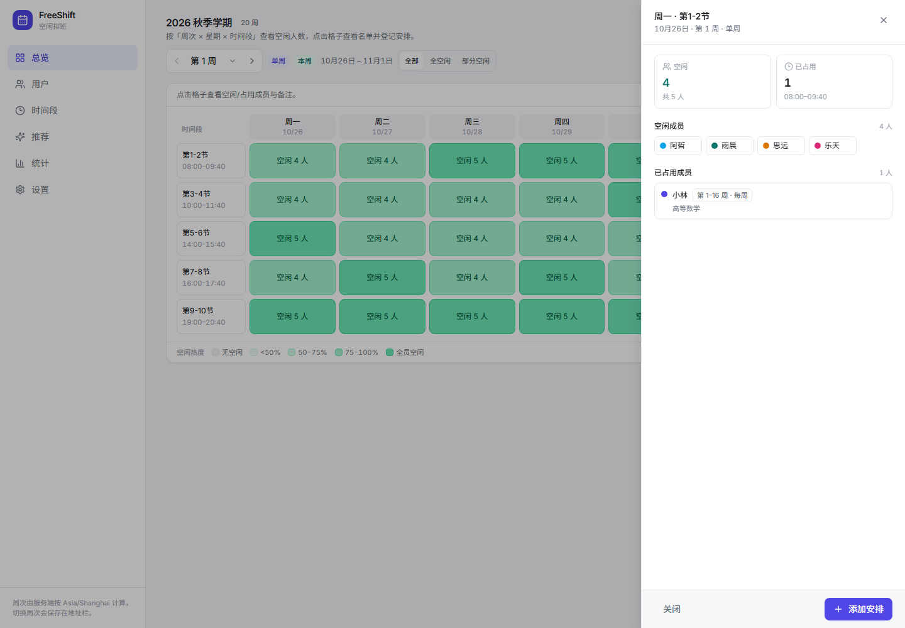
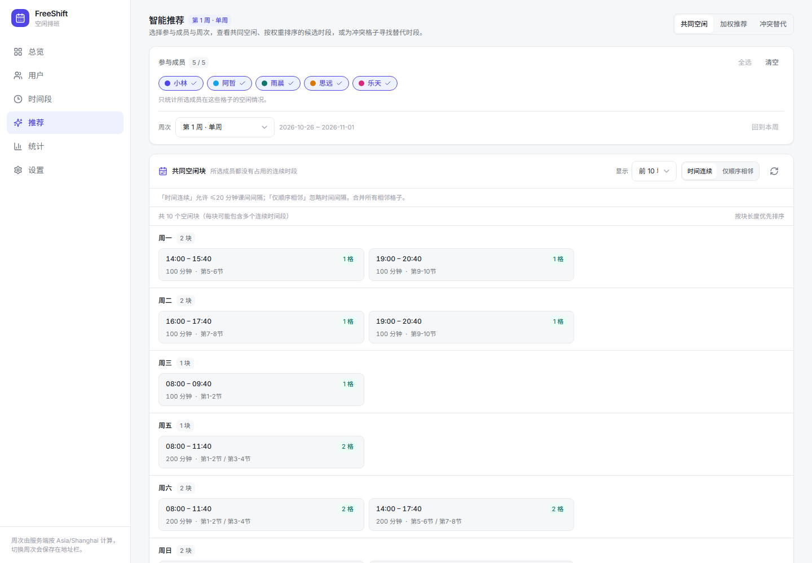
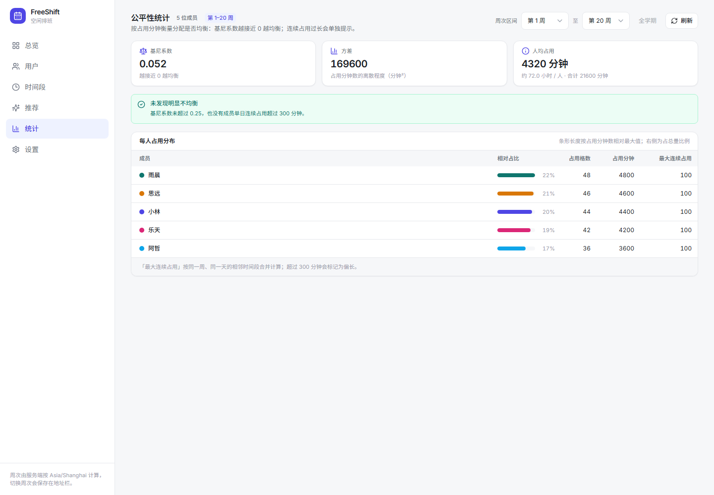

# FreeShift · 空闲排班

> Multi-User Free-Time Aggregation Scheduler —— 多人空闲时间聚合排班表

FreeShift 让一群人各自登记自己的占用（课程 / 上班 / 其他安排），系统按「周次 × 星期 × 时间段」聚合，回答两个问题：**这个时间段谁有空？**、**什么时候最适合一起安排？**

它不做自动分配班次，核心是 **空闲聚合 + 智能推荐**。

---

## 界面预览

| 总览：按周次聚合空闲（热力格 + 筛选） | 点格子查看空闲/占用名单 |
| --- | --- |
|  |  |

| 智能推荐：共同空闲 / 加权 / 冲突替代 | 公平性统计 |
| --- | --- |
|  |  |

演示数据：5 位成员、第 1 周、20 周学期（`pnpm seed` 可重建）。

## 功能

- **学期设置**：总周次、起始周一周日期、第 1 周单/双周规则，自动生成周历与日期。
- **时间段模板**：内置「大学两节连排 / 大学小节 / 半天制 / 空白模板」，可克隆后自定义每天的格子（起止时间、上午/下午/晚上、时长）。
- **用户管理**：增删改查、颜色、备注、排序、停用（保留历史）。
- **安排录入**：一条记录覆盖连续多周（如第 1~16 周），支持单双周；批量框选多个格子一次保存；保存前后做冲突检测。
- **主界面**：按周次查看 7 天 × 时间段的空闲人数热力格；点击格子查看空闲/占用名单；可切换某人的个人安排；「全部 / 全空闲 / 部分空闲」筛选；刷新按钮。
- **智能算法**：多人共同空闲时段（连续区间合并 Top-K）、五因子加权推荐（可调权重）、加安排时的冲突最小化替代时段、公平性统计（基尼系数）。
- **数据**：SQLite（WAL）持久化，CSV 导入导出（Excel 可直接打开）。

## 技术栈

| 层 | 选型 |
| --- | --- |
| 前端 | React 18 + TypeScript + Vite + Tailwind CSS + TanStack Query + React Router |
| 后端 | Node.js 24（原生 TypeScript 运行）+ Fastify 5 + Zod |
| 数据库 | SQLite（node:sqlite，WAL） |
| 部署 | Docker 多阶段构建 + Nginx（静态托管 + /api 反代） |

单机、低并发、小数据量（5~50 人 × 7 天 × 5~12 格 × 20 周），不引入 Redis / 消息队列，2 核 2G 可稳定运行。

---

## 本地开发

前置：Node.js >= 24（需要原生 TS 与 node:sqlite），pnpm >= 10。

~~~bash
pnpm install
pnpm --filter @freeshift/shared build   # 共享类型包需先构建
pnpm seed                               # 写入演示数据（首次运行会创建学期与模板）
pnpm dev                                # 同时启动 API(3000) 与前端(5173)
~~~

打开 http://127.0.0.1:5173 。前端通过 Vite 代理 /api 到 127.0.0.1:3000。

常用命令：

~~~bash
pnpm dev:server        # 只启后端
pnpm dev:web           # 只启前端
pnpm typecheck         # 全仓类型检查（先构建 shared）
pnpm test              # 后端 vitest
pnpm build             # 构建 shared 与前端静态产物
pnpm seed              # 演示数据（可重复执行，已存在的会跳过）
~~~

数据库默认位于 data/freeshift.db（可用 DATABASE_PATH 覆盖）。删除该文件即可重置。

### 环境变量

| 变量 | 默认 | 说明 |
| --- | --- | --- |
| DATABASE_PATH | ./data/freeshift.db | SQLite 文件路径 |
| PORT | 3000 | API 端口 |
| HOST | 0.0.0.0 | 监听地址 |
| TZ | Asia/Shanghai | 决定“当前周”的计算时区 |
| LOG_LEVEL | info | pino 日志级别 |

---

## Docker 部署（推荐）

~~~bash
docker compose build
docker compose up -d
docker compose ps
~~~

默认访问 http://<服务器IP>:8080 （可用 WEB_PORT=80 docker compose up -d 修改端口）。

- 两个服务：api（Node 24，SQLite 数据卷）+ web（Nginx，静态资源与 /api 反代）。
- 数据持久化在命名卷 freeshift-data，备份卷 freeshift-backups。
- 内存限制：api 384M、web 96M，适配 2G 内存小机器。
- 首次启动会自动执行建表、写入预设模板与默认学期（20 周、第 1 周为单周）。

初始化演示数据（可选）：

~~~bash
docker compose exec api node apps/server/src/db/seed.ts
~~~

### 备份与恢复

~~~bash
docker compose exec -T api node scripts/backup.mjs 7
# 备份文件在 freeshift-backups 卷中（/backups/freeshift-时间.db）
~~~

每日备份可加到宿主机 crontab：

~~~cron
30 3 * * * cd /opt/freeshift && docker compose exec -T api node scripts/backup.mjs 7
~~~

恢复：停止 api 容器 → 用备份文件覆盖数据卷中的 /data/freeshift.db（同时删除 -wal / -shm）→ 启动容器。

### 最简访问控制

FreeShift 自身不含账号体系。公网部署时建议二选一：

1. **Nginx Basic Auth**：在 deploy/nginx/default.conf 打开 auth_basic 两行，把 htpasswd 挂载到 /etc/nginx/htpasswd，并加 volume。
2. **Cloudflare Tunnel / Access** 或服务器安全组限制 IP。

## 项目结构

~~~text
FreeShift/
  apps/server/            Fastify API（routes / services / db / lib）
    src/db/schema.sql     数据库结构
    src/db/seed.ts        演示数据
    test/                 集成测试与算法测试
  apps/web/               React 前端
    src/components/ui     设计系统基础组件
    src/components/layout 应用外壳与导航
    src/components/schedule 主界面表格、抽屉、录入对话框
    src/pages             总览 / 用户 / 时间段 / 推荐 / 统计 / 设置
  packages/shared/        前后端共享类型、周次与单双周工具、算法常量
  deploy/                 Dockerfile 与 Nginx 配置
  docs/                   设计说明与 API 契约
  scripts/                备份脚本
  docker-compose.yml
~~~

## API 与算法

完整接口契约见 [docs/CONTRACT.md](docs/CONTRACT.md)，设计说明见 [docs/DESIGN.md](docs/DESIGN.md)。

核心端点：

| 方法 | 路径 | 说明 |
| --- | --- | --- |
| GET | /api/v1/semester | 学期 + 周历 |
| GET | /api/v1/board/aggregate?week=3 | 主界面聚合（人数 + 空闲名单） |
| GET | /api/v1/board/user/:id?week=3 | 个人安排视图 |
| POST | /api/v1/schedules | 新增安排（跨周 + 单双周，冲突 409） |
| POST | /api/v1/schedules/batch | 批量框选保存 |
| POST | /api/v1/recommend/common-free | 最佳共同空闲时段 |
| POST | /api/v1/recommend/scored | 多因子加权推荐 |
| POST | /api/v1/recommend/alternatives | 冲突最小化替代时段 |
| GET | /api/v1/stats/fairness | 公平性统计（基尼系数） |

聚合逻辑：安排写入时按周展开到 schedule_occurrence；主界面用「时间段 × 星期 × 用户」左连占用点求补集，人数与名单同源。算法细节（连续区间合并、五因子归一化加权、基尼系数）见设计文档第 3 节。

## 资源与运维

- 典型内存占用：api 80~150MB、web 10~20MB；compose 已限制 384M/96M。
- SQLite 使用 WAL，单实例部署；备份用 VACUUM INTO 生成一致性快照。
- 首次启动后查看日志：docker compose logs -f api。
- 健康检查：GET /healthz（api），容器内已配置 healthcheck。

## 已知限制

- 同一时间只有一个「启用学期」；数据模型支持多学期，但界面只管理当前学期。
- 时间段模板被当前学期安排引用后，切换/替换时间段会返回 409（数据不丢，可克隆模板后迁移）。
- 应用内无账号体系，公网部署请使用 Nginx Basic Auth 或 Cloudflare Access。
- 导入导出为 CSV（UTF-8 BOM，Excel 可直接打开），不提供 xlsx。
- 「共同空闲」的默认判定允许 ≤20 分钟课间间隔，可在页面上切换为仅按顺序相邻合并。

## 开发阶段

| 阶段 | 内容 |
| --- | --- |
| P0 | 脚手架、共享类型、数据库与种子、Docker 基础 |
| P1 | 学期 / 模板 / 用户 / 安排 CRUD、周次展开、冲突检测 |
| P2 | 聚合主界面、周次切换、抽屉、个人视图、批选录入 |
| P3 | 共同空闲、加权推荐、冲突替代、公平性统计 |
| P4 | CSV 导入导出、部署与文档、测试与联调 |